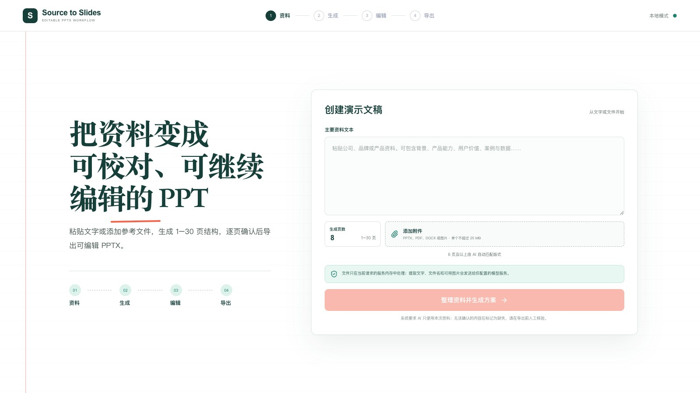

<h1 align="center">Source to Slides</h1>

<p align="center">
  <strong>把文本与参考文件，变成可校对、可追溯、可继续编辑的 PowerPoint。</strong>
</p>

<p align="center">
  一个本地运行的 AI 演示文稿工作流：读取资料、生成 1–30 页结构、逐页确认内容与版式，最后导出 16:9 可编辑 PPTX。
</p>

<p align="center">
  
  
  
  
  
  <a href="https://github.com/702129770-lgtm/source-to-slides/actions/workflows/ci.yml"></a>
  <a href="LICENSE"></a>
</p>

<p align="center">
  <a href="#产品演示">产品演示</a> ·
  <a href="#核心能力">核心能力</a> ·
  <a href="#快速开始">快速开始</a> ·
  <a href="#工作原理">工作原理</a> ·
  <a href="#数据与安全">数据与安全</a> ·
  <a href="#当前状态">当前状态</a> ·
  <a href="#参与贡献">参与贡献</a>
</p>

<p align="center">
  
</p>

## 为什么做这个项目

常见的 AI PPT 流程要么只生成一段大纲，要么直接交付无法核对来源、难以继续修改的结果。Source to Slides 把生成过程拆成一条可检查的工作流：

1. **先读资料**：提取文字与可用图片，而不是从空白提示词开始猜。
2. **再生成结构**：使用严格 JSON Schema 输出指定页数的逐页内容。
3. **保留人工确认**：用户可以逐页编辑、排序、删除和切换兼容版式。
4. **最后交付文件**：导出文字与形状可继续编辑的 16:9 PowerPoint。

> 当前版本是本地 MVP，不是已经具备账号、存储和多人隔离能力的公网 SaaS。

## 产品演示

从资料输入到版式选择，以下画面均由当前仓库代码在本地实际运行生成。

<table>
  <tr>
    <td width="50%"></td>
    <td width="50%"></td>
  </tr>
  <tr>
    <td><strong>多格式资料输入</strong><br>粘贴主要文字，设置 1–30 页目标，并补充 PPTX、PDF、DOCX 或图片。</td>
    <td><strong>三栏逐页编辑</strong><br>页面顺序、16:9 预览和内容面板同时可见，导出前可继续修改并检查容量。</td>
  </tr>
</table>

## 核心能力

| 环节 | 当前能力 |
|---|---|
| 资料输入 | 输入主要文字，并上传 PPTX、PDF、DOCX、PNG、JPG/JPEG、WEBP |
| 内容读取 | 提取 PowerPoint、Word、PDF 正文，以及 PowerPoint、Word 内嵌图片 |
| AI 生成 | 使用 OpenAI Responses API 与严格 JSON Schema 生成恰好 1–30 页内容 |
| 版式选择 | 1–5 页由用户逐页指定版式；6 页及以上由 AI 自动匹配 |
| 内容确认 | 编辑标题、副标题、正文、要点和结论，支持移动、删除及兼容版式切换 |
| 容量保护 | 内容超过版式容量时阻止预览和导出，避免文字被静默裁切 |
| 素材使用 | AI 选择与页面相关的图片，并说明未使用素材或附件的原因 |
| 来源追踪 | 每页保留来源标签，并显示缺失信息警告 |
| PPTX 导出 | 生成 16:9 PPTX，标题、文字和形状可继续编辑 |

## 工作原理


生成链路：

```text
文本 + 目标页数 + 可选附件
  → POST /api/generate
  → 文档与图片提取
  → OpenAI Responses API
  → DeckDraft JSON Schema
  → 人工确认与编辑
  → PptxGenJS 导出
```

系统不会在失败时回退到固定示例。缺少密钥、附件无法读取或模型请求失败时，页面会显示真实错误，并保留用户已经输入和选择的资料。

## 快速开始

### 1. 安装依赖

```bash
pnpm install
cp .env.example .env
```

### 2. 配置模型

```dotenv
OPENAI_API_KEY=your_api_key_here
OPENAI_BASE_URL=
OPENAI_MODEL=gpt-5.5
PORT=8787
HOST=127.0.0.1
TRUSTED_ORIGINS=
```

`OPENAI_BASE_URL` 为可选项。API Key 只由服务端读取，不会打包进浏览器代码。

默认只监听本机回环地址。需要容器或局域网访问时再显式设置 `HOST=0.0.0.0`，并通过逗号分隔的 `TRUSTED_ORIGINS` 配置允许访问生成接口的来源。

### 3. 开发模式

```bash
pnpm dev
```

- Web UI：`http://127.0.0.1:5173`
- API 健康检查：`http://127.0.0.1:8787/api/health`

### 4. 本地构建与运行

```bash
pnpm build
pnpm start
```

构建后打开 `http://127.0.0.1:8787`。

### 5. 验证

```bash
pnpm test
pnpm lint
pnpm build
pnpm audit:dependencies
```

## 支持范围

| 输入 | 当前处理方式 |
|---|---|
| 直接输入文字 | 作为主要资料发送给生成接口 |
| PPTX | 提取每页正文与最多 12 张内嵌图片 |
| DOCX | 提取正文与最多 12 张内嵌图片 |
| PDF | 提取正文，暂不提取 PDF 内图片 |
| PNG / JPG / JPEG / WEBP | 作为视觉输入提供给模型选择 |

每次请求最多接收 12 个文件，单个文件上限为 25 MB，附件总量上限为 75 MiB，可用图片总量上限为 32 MiB。来源正文进入模型前最多保留 120,000 个字符。

## 数据与安全

- `OPENAI_API_KEY` 只在服务端读取，不进入前端代码或上传表单。
- 上传文件使用进程内存处理；当前没有数据库、对象存储或项目持久化。
- 提取文字、附件文件名和全部可用图片会发送到 `.env` 中配置的 OpenAI API 或兼容端点，供模型判断是否使用；未被放入页面的图片也可能已经发送。
- 当前实现不把上传文件写入磁盘；文件仅存在于当前请求的服务内存中。
- 服务默认监听 `127.0.0.1`，生成接口会校验浏览器来源；这不是身份验证的替代品。
- 当前版本面向本地试用，不应直接作为多人公网服务部署。
- 不要在未确认模型服务商数据政策的情况下上传机密、个人敏感或受监管资料。

完整边界和公网部署清单见 [数据与安全说明](docs/data-and-security.md)。

## 技术栈

| 层 | 技术 |
|---|---|
| Web | React 19、TypeScript、Vite |
| API | Express 5、Multer |
| AI | OpenAI SDK、Responses API、严格 JSON Schema |
| 内容解析 | JSZip、pdf-parse、Cheerio |
| PPTX 导出 | PptxGenJS |
| 测试 | Vitest、Testing Library |

## 项目结构

```text
source-to-slides/
├── server/                 # API、资料提取、模型请求与 Deck 生成
├── src/
│   ├── app/                # 应用入口与步骤状态
│   ├── domain/             # Deck 模型、版式规则与容量约束
│   ├── features/           # 上传、生成、编辑、预览与页面组件
│   ├── services/           # API 适配与 PPTX 导出
│   └── styles/             # 视觉令牌与界面样式
├── docs/                   # 公开架构与数据安全说明
├── .github/                # CI、Dependabot 与协作模板
├── .env.example
├── LICENSE
└── package.json
```

## 当前状态

已经具备：

- 真实 OpenAI 生成链路与严格结构化输出
- 多格式文字提取与 Office 内嵌图片读取
- 固定版式、容量保护、来源标记与缺失警告
- 逐页编辑、16:9 预览和可编辑 PPTX 导出
- 自动化测试覆盖核心生成、校验、编辑和导出逻辑

尚未具备：

- 账号、数据库、项目保存、版本历史与多人协作
- 异步任务队列、生成取消、重试管理与运行监控
- 公网部署需要的任务隔离、限流和自动数据清理
- PowerPoint 模板导入与多品牌主题系统
- PDF 图片提取和更完整的素材管理

## Roadmap

- [ ] 增加品牌主题与可配置设计令牌
- [ ] 支持导入和复用 PowerPoint 模板
- [ ] 增加项目保存、版本历史与再次编辑
- [ ] 增加异步任务、进度反馈、取消与重试
- [ ] 增加 PDF 图片提取与更完整的素材管理
- [ ] 增加身份验证、任务隔离、限流和自动数据清理

## 参与贡献

欢迎提交问题、功能建议和改进。开始前请阅读 [贡献指南](CONTRIBUTING.md)；安全问题请不要公开披露，按照 [安全政策](SECURITY.md) 私密报告。

- [提交问题](https://github.com/702129770-lgtm/source-to-slides/issues/new/choose)
- [贡献指南](CONTRIBUTING.md)
- [行为准则](CODE_OF_CONDUCT.md)
- [安全政策](SECURITY.md)

## 项目文档

- [系统架构](docs/architecture.md)
- [数据与安全](docs/data-and-security.md)
- [贡献指南](CONTRIBUTING.md)
- [第三方许可说明](THIRD_PARTY_NOTICES.md)
- [商标说明](TRADEMARKS.md)

## License

Source to Slides 采用 [Apache License 2.0](LICENSE) 开源。使用、修改和分发时请遵守许可证、[NOTICE](NOTICE) 与 [第三方许可说明](THIRD_PARTY_NOTICES.md)。项目名称和视觉身份不随软件许可证授权，详见 [商标说明](TRADEMARKS.md)。

Source to Slides 是独立项目，与 OpenAI 或 Microsoft 没有隶属或背书关系。

---

<p align="center">
  <strong>Source-grounded · Human-reviewed · Editable by default</strong>
</p>
