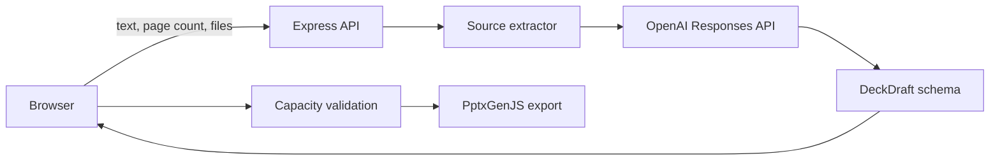

# Architecture

GZL PPT 是一个面向本地单用户场景的 React + Express 应用。浏览器负责资料选择、逐页编辑、预览和 PPTX 下载；服务端负责文件解析与模型调用。

## Data flow

## Module ownership

| Module | Responsibility |
|---|---|
| `src/app` | Wizard state and step transitions |
| `src/features/upload` | Text, file and page-count input |
| `src/features/editor` | Page ordering, editing and compatible layouts |
| `src/features/slides` | Browser-side 16:9 rendering |
| `src/domain` | Deck model and layout capacity rules |
| `src/services` | API adapter and PPTX export |
| `server` | Request validation, source extraction and model generation |

## Design principles

- Source-grounded: generated content must map back to supplied text or files.
- Human-reviewed: users confirm each page before export.
- Editable output: text and shapes remain editable in PowerPoint.
- Honest failure: missing configuration, parsing errors and model errors are surfaced rather than replaced with demo data.
- One capacity model: editor, preview and exporter share the same layout limits so content is not silently truncated.

## Current deployment boundary

The default host is loopback-only. This repository does not provide authentication, tenant isolation, persistent projects, queues or production observability. Any public deployment needs additional security and operational work described in [data-and-security.md](data-and-security.md).
